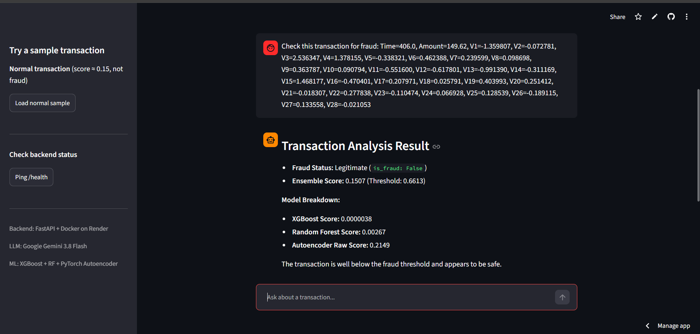
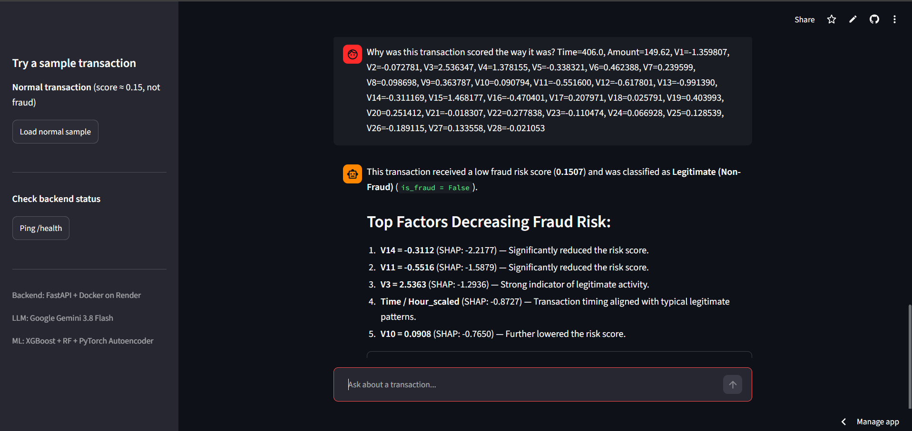
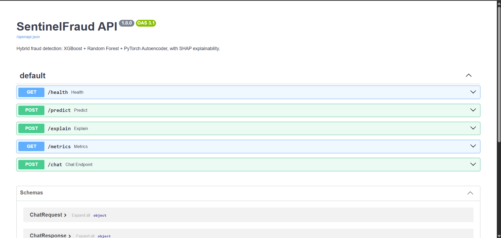

# SentinelFraud

Hybrid fraud detection with LLM interface — XGBoost + Random Forest + PyTorch Autoencoder, with SHAP explainability and Google Gemini function calling.

**🔗 Live Demo:** [sentinelfraud.streamlit.app](https://sentinelfraud.streamlit.app)  
**📖 API Docs:** [sentinelfraud.onrender.com/docs](https://sentinelfraud.onrender.com/docs)



---

## Problem

Credit card fraud is rare — only **0.172%** of transactions in this dataset (492 out of 284,807). Accuracy is a useless metric here: a model that predicts "no fraud" every time gets **99.83% accuracy** but catches zero fraud. The model must be evaluated on **AUC-PR, Recall, and Precision** instead.

## Approach

I built an ensemble of three models:

1. **XGBoost** — catches known fraud patterns, high precision
2. **Random Forest** — adds diversity to the ensemble
3. **Autoencoder (PyTorch)** — trained only on normal transactions, flags anomalies by reconstruction error. This catches fraud patterns the supervised models haven't seen.

Final scores are combined with weights (XGBoost 0.60, Random Forest 0.25, Autoencoder 0.15). Every prediction is explained with SHAP.

---

## Results

| Model | AUC-PR | Recall | Precision | F1 |
|-------|:------:|:------:|:---------:|:--:|
| Logistic Regression | 0.6715 | 0.8737 | 0.0552 | 0.1038 |
| Random Forest | 0.7843 | 0.7684 | 0.8295 | 0.7978 |
| Autoencoder | 0.4021 | 0.5158 | 0.4298 | 0.4689 |
| XGBoost | **0.8274** | 0.7684 | 0.9359 | 0.8439 |
| **Weighted Ensemble** | 0.8181 | 0.7579 | **0.9730** | **0.8521** |

The ensemble wins on F1 and Precision. Only **2.7%** of its fraud alerts are false positives, compared to 6.4% for XGBoost alone.

### Top fraud drivers (SHAP)

1. V14 (importance 2.68)
2. V4 (1.67)
3. V12 (1.21)
4. V10 (0.89)
5. V11 (0.82)

Engineered features `Hour_scaled` and `Amount_scaled` also ranked in the top 10.

---

## LLM-Powered Chat Interface

A natural-language interface powered by **Google Gemini 3.8 Flash** with **function calling**. Analysts can ask questions in plain English and get SHAP-grounded explanations.

> *"Check this transaction for fraud: Time=406, Amount=149.62, V1=-1.36, ..."*

The LLM:
1. Parses the natural-language message
2. Decides which tool to call (`predict_tool` or `explain_tool`)
3. Executes the tool against the real ML ensemble
4. Returns SHAP-grounded explanations

**Live UI:** [sentinelfraud.streamlit.app](https://sentinelfraud.streamlit.app)



---

## API

FastAPI service exposing five endpoints:

| Method | Endpoint | Purpose |
|--------|----------|---------|
| GET | `/health` | Health check |
| POST | `/predict` | Score a transaction for fraud |
| POST | `/explain` | SHAP reasons for a prediction |
| GET | `/metrics` | Model performance summary |
| POST | `/chat` | Natural language fraud analysis |
| GET | `/docs` | Swagger UI |



### Example request

```bash
curl -X POST http://127.0.0.1:8000/predict -H "Content-Type: application/json" -d "{\"Time\":406.0,\"V1\":-1.35,\"Amount\":149.62}"
```

### Example response

```json
{
  "ensemble_score": 0.1507,
  "is_fraud": false,
  "threshold": 0.6613,
  "xgb_score": 0.0000038,
  "rf_score": 0.0027,
  "ae_raw_score": 0.2149
}
```

---

## Run Locally

### With Docker

```bash
docker build -t sentinelfraud:latest .
docker run -p 8000:8000 sentinelfraud:latest
```

Open http://127.0.0.1:8000/docs

### Without Docker

```bash
python -m venv .venv
.venv\Scripts\activate
pip install -r requirements.txt
uvicorn api.main:app --reload
```

**Environment variables required:**

```
GEMINI_API_KEY=your_gemini_api_key
```

Set this in a `.env` file at the project root or as a shell environment variable.

---

## Project Structure

```
sentinelfraud/
  api/                    FastAPI service
    main.py               Endpoints
    schemas.py            Pydantic validation
    model_loader.py       Model inference wrapper
    chat.py               LLM agent with function calling
  src/                    Reusable modules
    features.py           Preprocessing pipeline
    model_loader.py       Model loading
  models/                 Trained artifacts
  notebooks/              Development notebooks
    01_eda.ipynb
    02_feature_engineering.ipynb
    03_model_training.ipynb
    04_autoencoder.ipynb
    05_ensemble.ipynb
    06_explainability.ipynb
  data/
    raw/
    processed/
  app.py                  Streamlit chat UI
  Dockerfile
  docker-compose.yml
  requirements.txt
  README.md
```

---

## Tech Stack

- **Python 3.11**
- **scikit-learn** — Logistic Regression, Random Forest
- **XGBoost** — gradient boosting
- **PyTorch** — autoencoder for anomaly detection
- **SHAP** — model explainability
- **FastAPI** — REST API
- **Google Gemini 3.8 Flash** — LLM with function calling
- **Streamlit** — chat UI
- **Docker** — containerization
- **Render + Streamlit Cloud** — deployment

---

## Dataset

ULB Credit Card Fraud Detection Dataset (Kaggle) — 284,807 transactions, 492 frauds, 30 anonymized features (V1–V28, Time, Amount).

---

## Contact

**Sumit Kamble**
- GitHub: [@Sam-py-21](https://github.com/Sam-py-21)
- LinkedIn: [linkedin.com/in/sumit-kamble-2b66162b8](https://www.linkedin.com/in/sumit-kamble-2b66162b8)
- Email: sumit.kamble.5242@gmail.com